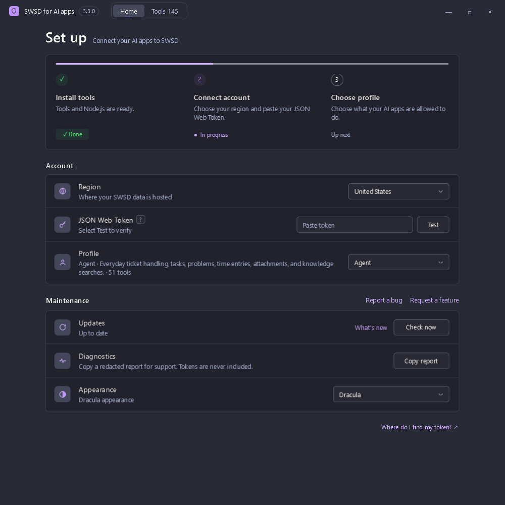
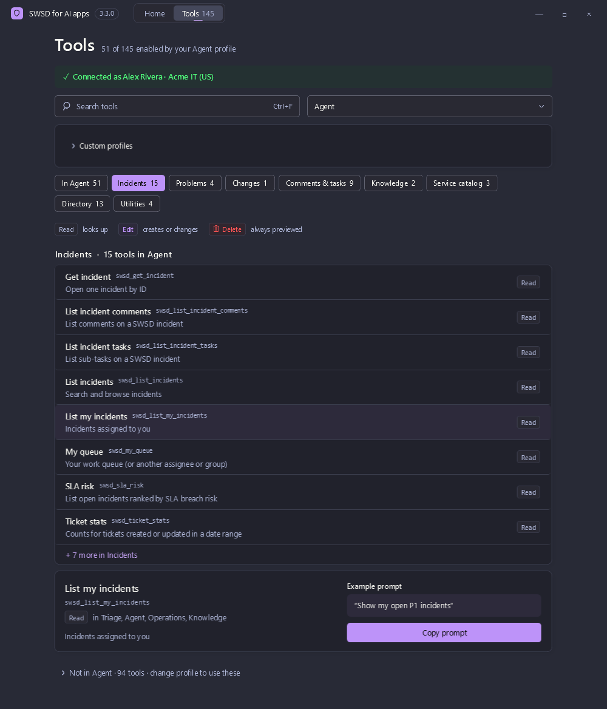
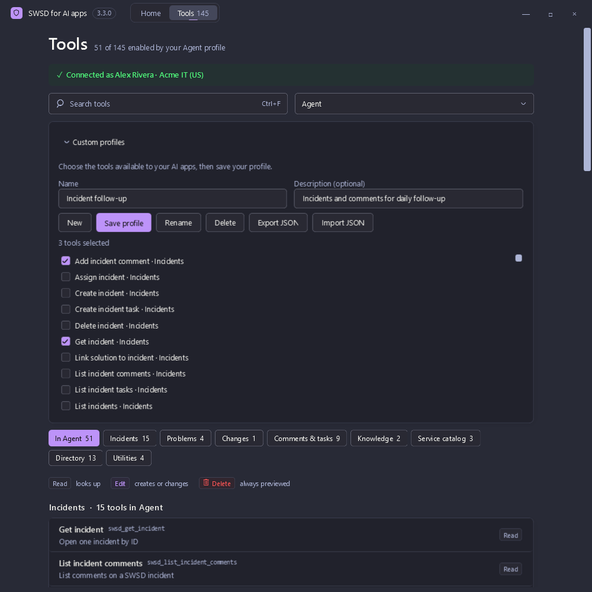
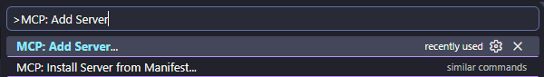
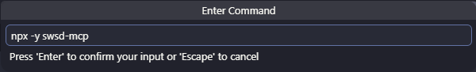
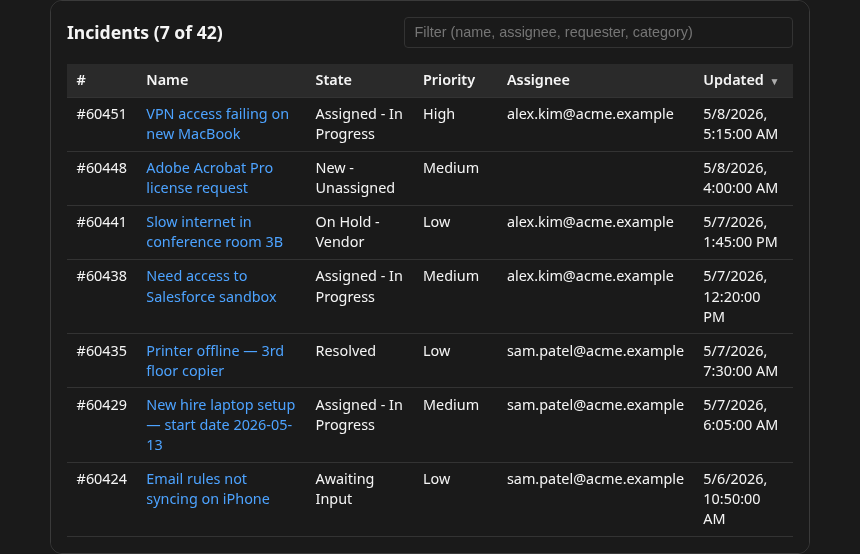

# swsd-mcp

[](https://github.com/mikimatsub/swsd-mcp/actions/workflows/ci.yml)
[](https://github.com/mikimatsub/swsd-mcp/actions/workflows/security.yml)
[](https://www.npmjs.com/package/swsd-mcp)
[](https://registry.modelcontextprotocol.io/v0.1/servers?search=io.github.mikimatsub/swsd)
[](./LICENSE)
[](https://www.npmjs.com/package/swsd-mcp)

**MCP server for SolarWinds Service Desk (SWSD / Samanage).** Works with any [Model Context Protocol](https://modelcontextprotocol.io) client to handle tickets, service requests, knowledge-base work, change/release workflows, assets/CMDB context, procurement records, risks, time entries, and attachments using each user's own SWSD JSON Web Token. See the [client compatibility matrix](https://mcp-swsd.pages.dev/compatibility/) for transport and widget guidance.

📖 **Full docs:** [mcp-swsd.pages.dev](https://mcp-swsd.pages.dev)

The server holds **zero credentials at rest**. HTTP tokens are supplied per request; stdio keeps the configured token for the process lifetime. The Windows companion saves the user's JSON Web Token in Windows Credential Manager, and the MCP server does not save it to disk.

---

## Windows companion app

**SWSD for AI apps** installs swsd-mcp on this PC and chooses which tools your AI apps can use. Your JSON Web Token is saved in Windows Credential Manager. The [Windows companion app](https://mcp-swsd.pages.dev/windows/) page has the full guide. Pictures use example data.

### Set up this PC

1. Install the Windows `swsd` plugin.
2. Start a new local chat and ask to set up SWSD on this computer.
3. On **Set up**, select **Install tools**. This setup needs Node.js 24.15 or newer within version 24, or Node.js 26 or newer, with npm. Node 25 is not supported. If Node.js is missing or outside those versions, setup can install the current Node.js LTS through winget after you confirm. Windows may ask for administrator approval. Reopen the app when installation finishes.
4. Choose **United States** or **Europe**, paste your JSON Web Token, and select **Test**. The field stays masked. **?** and **Where do I find my token?** show where to copy it in SWSD. Generate a JSON Web Token only when none is shown.
5. Choose **Triage** (22 tools), **Agent** (52), **Knowledge** (17), **Operations** (146), or a saved custom profile. The choice is saved immediately. Quit and reopen the AI app, then start a new chat so the server loads that profile.
6. Open it again from **SWSD Setup** on the Start menu.



*Install the tools, then add your JSON Web Token.*

### Connection and status

**Home** shows Node.js, the installed tools, your JSON Web Token, region, profile, and updates. The token stays masked. **Test** checks the connection and marks it **Verified**. Changing **United States** or **Europe** clears that check until you select **Test** again. **Repair** reinstalls the tools. **Remove saved JSON Web Token** deletes the credential on this PC. Quit the AI app afterwards. The token remains valid in SWSD until it is revoked there.

### Tool guide

**Tools** is a searchable catalog of all 146 tools for the profile you select. **Ctrl+F** focuses search, which matches the friendly name, the tool id, and the description. Each tool is marked **Read**, **Edit**, or **Delete**. Read looks up a record, Edit creates or changes one, and Delete always previews the record first. Tools outside the profile stay grouped apart until you search. A match can point you to a profile that includes it, and you can switch to that profile from the detail. Select a tool to see where it is available and copy an example prompt.



*See which tools a profile includes, and copy an example prompt.*

### Custom profiles

On **Tools**, open **Custom profiles** to name a set and check the tools your AI apps may use. **Save profile** makes that set active and adds it to the Home and Tools pickers. **Rename**, **Delete**, and **New** manage the set. Deleting the active custom profile returns you to **Agent**.

**Export JSON** saves the profile as a file you can share. **Import JSON** loads a file into the builder. Select **Save profile** to start using an import. The file is the version-1 profile in [Custom profiles](https://mcp-swsd.pages.dev/configuration/#custom-profiles): `name`, `version`, `tools`, and an optional `description`. Extra fields are rejected. Names that match Triage, Agent, Knowledge, Operations, or Full are reserved.



*Choose the tools in a named profile, then save or share it as JSON.*

### Appearance

**Appearance** follows **Match Windows**, or you can choose **Light**, **Dark**, or a named theme. The choice is saved on this PC. Named themes are Dracula, Catppuccin Mocha, Catppuccin Macchiato, Catppuccin Frappe, Catppuccin Latte, Nord, Gruvbox Dark, Gruvbox Light, Tokyo Night, Tokyo Night Storm, Tokyo Night Day, One Dark, One Light, Solarized Dark, Solarized Light, Rosé Pine, Rosé Pine Moon, Rosé Pine Dawn, Monokai, Material Ocean, GitHub Dark, and GitHub Light.

### Updates, diagnostics, and release notes

**Check now** looks for a newer published release. When one is available, **Update** installs it after checking the package, and keeps your current tools if the install does not finish. **What's new** opens the release notes on this PC, including changes that are not published yet. **Copy report** copies a diagnostics summary for support: versions, whether tools are installed, the profile, the region, whether a credential is saved, display scale, and a short redacted log. The report does not include your token.

### Help and issue links

**Report a bug** and **Request a feature** open the GitHub forms with the app version, server version, Windows version, and profile filled in.

---

## Quick start

You need:

- An MCP client installed: the client must support stdio or Streamable HTTP ([compatibility matrix](https://mcp-swsd.pages.dev/compatibility/))
- Node.js 24.15+ or Node.js 26+ for local npm/`npx` installs. Node 25 is not supported.
- An SWSD **JSON Web Token**: in **Setup → Users & Groups → Users**, open your User detail page and copy the existing token. Use **Actions → Generate JSON Web Token** only when no token is shown (SWSD administrator rights required to generate)

### VS Code

1. Open the Command Palette: **Ctrl+Shift+P** on Windows/Linux or **Shift+Command+P** on macOS.
2. Run **MCP: Add Server...**.



3. Install with either supported local option:

   - **Command (stdio)**: enter `npx -y swsd-mcp`.
   - **NPM Package**: enter `swsd-mcp`, confirm that the publisher is **`mikimatsub`**, then select **Allow**.



4. Name the server `swsd`, then choose **Global** for your VS Code profile or **Workspace** for the current project.
5. [Add the SWSD token securely and verify the connection](https://mcp-swsd.pages.dev/quickstart/#secure-vs-code-token-configuration).

### Other stdio clients

### 1. Add the config

Claude Desktop and Cursor use this JSON shape. Add the `swsd` entry inside the `mcpServers` object in your client's config file:

```json
{
  "mcpServers": {
    "swsd": {
      "command": "npx",
      "args": ["-y", "swsd-mcp"],
      "env": {
        "SWSD_TOKEN": "your-jwt-here",
        "SWSD_BASE_URL": "https://api.samanage.com"
      }
    }
  }
}
```

Replace `your-jwt-here` with your token. EU tenants use `https://apieu.samanage.com` instead. To customize behavior, add any [configuration variable](https://mcp-swsd.pages.dev/configuration/) (most common: `SWSD_PROFILE` to choose the tool set) into the same `env` block.

### 2. Drop it in the right file

| Client | Config file path |
|---|---|
| Claude Desktop (macOS) | `~/Library/Application Support/Claude/claude_desktop_config.json` |
| Claude Desktop (Windows) | `%APPDATA%\Claude\claude_desktop_config.json` |
| Claude Code | `~/.claude.json` (or use the shortcut below) |
| Cursor | `~/.cursor/mcp.json` |
| Continue, Cline, other clients | check your client's docs for its configuration format |

Create the file if it doesn't exist. Then restart your client.

**Windows plugin setup:** after installing the Windows `swsd` plugin, start a new local chat and ask to set up SWSD on this computer. Reopen setup from the Windows Start menu. The WPF settings window has Home and Tools tabs.
Appearance offers **Match Windows**, **Light**, **Dark**, and named themes such as Dracula, Catppuccin, Nord, Gruvbox, and Tokyo Night, saved on this PC.
Browse tools by area, search with **Ctrl+F**, inspect Read/Edit/Delete badges and
example prompts, and select a profile to change the available tool set. The **?**
beside **JSON Web Token** shows the SWSD User detail screen and **Actions →
Generate JSON Web Token**, used only when no token is shown. Test verifies the
connection and stores the JSON Web Token in Windows Credential Manager. Home also provides tool installation/repair, update checks, and US/EU region selection. The picker offers Triage, Agent, Knowledge, Operations, and saved custom profiles. On the Tools page, build a custom profile, then save, rename, delete, import, or export it. Other MCP clients still use the server configuration below (`SWSD_PROFILE=custom`). Tools and settings live under `%LOCALAPPDATA%\swsd-mcp`. Restart the desktop app and start a new chat after a profile change.

The [Windows companion app](#windows-companion-app) section above is the setup and day-to-day guide, with the [full page](https://mcp-swsd.pages.dev/windows/) on the docs site.

**Claude Code shortcut**: skip editing the file by hand. This saves a private entry for the current project in `~/.claude.json`:

```bash
claude mcp add swsd --env SWSD_TOKEN="your-jwt-here" --env SWSD_BASE_URL="https://api.samanage.com" -- npx -y swsd-mcp
```

**Microsoft Copilot Studio**: different path. Copilot Studio can't spawn local processes, so it needs an HTTP-transport server. See [`copilot-studio/README.md`](./copilot-studio/README.md) and the [Azure Container Apps recipe](./docs/deployment/azure-container-apps.md).

### 3. Verify it works

In your MCP client, ask:

> _"Use swsd to check if you can connect."_

The agent should call `swsd_health_check` and report success. If it does, you're set up. Try a few more:

- _"Show me incident 60310"_: incident reference tools accept either the internal id (≥7 digits) or the human-facing number visible in the SWSD UI (≤6 digits); other tools may require internal ids.
- _"List incidents updated in the last 7 days"_: `updated_within: "7d"` (also `"24h"`, `"1w"`, `"30d"`).
- _"What tickets are assigned to me?"_: `swsd_list_my_incidents` resolves your email from the JWT and user record, then filters each fetched page locally. Scan metadata reports any remaining candidates.

---

## Tools (146 across 15 categories)

| Category | Tools |
|---|---|
| **Utility** | `swsd_get_server_info`, `swsd_health_check`, `swsd_get_me` |
| **Incidents** | `swsd_list_incidents`, `swsd_list_my_incidents`, `swsd_sla_risk`, `swsd_ticket_stats`, `swsd_my_queue`, `swsd_get_incident`, `swsd_create_incident`, `swsd_update_incident`, `swsd_assign_incident`, `swsd_update_incident_state`, `swsd_link_solution_to_incident`, `swsd_delete_incident` |
| **Comments** | `swsd_list_incident_comments`, `swsd_add_incident_comment`, `swsd_update_comment`, `swsd_list_record_comments`, `swsd_add_record_comment`, `swsd_delete_comment` |
| **Tasks** | `swsd_list_incident_tasks`, `swsd_create_incident_task`, `swsd_update_task_state`, `swsd_list_record_tasks`, `swsd_create_record_task`, `swsd_update_task`, `swsd_delete_task` |
| **Problems** | `swsd_list_problems`, `swsd_get_problem`, `swsd_create_problem`, `swsd_update_problem`, `swsd_delete_problem` |
| **Change & Release** | `swsd_change_calendar`, `swsd_list_changes`, `swsd_get_change`, `swsd_create_change`, `swsd_update_change`, `swsd_delete_change`, `swsd_list_releases`, `swsd_get_release`, `swsd_create_release`, `swsd_update_release`, `swsd_delete_release` |
| **Assets & CMDB** | `swsd_list_hardware_assets`, `swsd_get_hardware_asset`, `swsd_list_hardware_warranties`, `swsd_create_hardware_asset`, `swsd_update_hardware_asset`, `swsd_add_hardware_warranty`, `swsd_update_hardware_warranty`, `swsd_delete_hardware_warranty`, `swsd_delete_hardware_asset`, `swsd_list_mobile_devices`, `swsd_get_mobile_device`, `swsd_create_mobile_device`, `swsd_update_mobile_device`, `swsd_delete_mobile_device`, `swsd_list_printers`, `swsd_get_printer`, `swsd_update_printer`, `swsd_list_software_assets`, `swsd_get_software_asset`, `swsd_list_other_assets`, `swsd_get_other_asset`, `swsd_create_other_asset`, `swsd_update_other_asset`, `swsd_delete_other_asset`, `swsd_list_configuration_items`, `swsd_get_configuration_item`, `swsd_create_configuration_item`, `swsd_update_configuration_item`, `swsd_delete_configuration_item` |
| **Procurement & Risk** | `swsd_list_contracts`, `swsd_get_contract`, `swsd_create_contract`, `swsd_update_contract`, `swsd_add_contract_item`, `swsd_delete_contract`, `swsd_list_purchase_orders`, `swsd_get_purchase_order`, `swsd_create_purchase_order`, `swsd_update_purchase_order`, `swsd_delete_purchase_order`, `swsd_list_vendors`, `swsd_get_vendor`, `swsd_create_vendor`, `swsd_update_vendor`, `swsd_delete_vendor`, `swsd_list_change_catalogs`, `swsd_get_change_catalog`, `swsd_create_change_catalog`, `swsd_update_change_catalog`, `swsd_delete_change_catalog`, `swsd_list_risks` |
| **Time tracking** | `swsd_list_time_tracks`, `swsd_log_time`, `swsd_update_time_track`, `swsd_delete_time_track` |
| **Attachments** | `swsd_get_incident_attachment`, `swsd_upload_attachment` |
| **Solutions / KB** | `swsd_search_solutions`, `swsd_get_solution`, `swsd_create_solution`, `swsd_update_solution`, `swsd_delete_solution` |
| **Service Catalog** | `swsd_list_catalog_items`, `swsd_get_catalog_item`, `swsd_create_catalog_item`, `swsd_update_catalog_item`, `swsd_delete_catalog_item`, `swsd_create_service_request` |
| **Lookups** | `swsd_list_categories`, `swsd_get_category`, `swsd_create_category`, `swsd_update_category`, `swsd_delete_category`, `swsd_list_sites`, `swsd_get_site`, `swsd_create_site`, `swsd_update_site`, `swsd_delete_site`, `swsd_list_departments`, `swsd_get_department`, `swsd_create_department`, `swsd_update_department`, `swsd_delete_department`, `swsd_list_users`, `swsd_get_user`, `swsd_create_user`, `swsd_update_user`, `swsd_delete_user`, `swsd_list_groups`, `swsd_get_group`, `swsd_create_group`, `swsd_update_group`, `swsd_delete_group`, `swsd_add_group_member`, `swsd_remove_group_member`, `swsd_list_roles`, `swsd_get_role`, `swsd_create_role`, `swsd_update_role`, `swsd_delete_role` |
| **Custom fields** | `swsd_describe_custom_fields` |
| **Audits** | `swsd_get_record_audits` |

Each tool's input schema and description are discovered by your MCP client at runtime; calls return structured results. See the [Tools reference](https://mcp-swsd.pages.dev/tools/) for full per-tool documentation.

---

## MCP Apps widgets (rich UI)

Ten interactive UI bundles ship with read tools using the [MCP Apps extension](https://modelcontextprotocol.io/extensions/apps/overview). On hosts that support MCP Apps, the tool returns a rendered widget alongside the structured response. On hosts without a widget surface, the same tools return their normal structured payload.



*Example: `swsd_list_incidents` rendering the `incident-list` widget. Synthetic data; no real tenant info. See the [full gallery](https://mcp-swsd.pages.dev/widgets/) for screenshots of all ten widgets.*

| Tool | Widget | What it renders |
|---|---|---|
| `swsd_get_incident` | `incident-detail` | Single-record card (description, due date, SLA-violation count, resolution) |
| `swsd_get_solution` | `solution-detail` | Knowledge-base article with sanitized HTML body |
| `swsd_list_incidents`, `swsd_list_my_incidents`, `swsd_my_queue` | `incident-list` | Filterable, sortable table |
| `swsd_sla_risk` | `sla-risk` | Risk-count chips + color-coded table with due countdowns |
| `swsd_list_incident_comments` | `comment-thread` | Vertical conversation with author chips and private badges |
| `swsd_get_record_audits` | `audit-timeline` | Timeline grouped by day with action chips and field diffs |
| `swsd_get_catalog_item` | `catalog-item-form` | Form that submits via `swsd_create_service_request` |
| `swsd_describe_custom_fields` | `custom-fields` | Searchable explorer with scope/module filters |
| `swsd_change_calendar` | `change-calendar` | Local-time day sections for changes/releases with shared-CI/group conflict badges |
| `swsd_ticket_stats` | `ticket-stats` | Summary tiles, median resolution time, and state/priority/assignee/category breakdowns |

`swsd_change_calendar` is read-only and available in Agent and Operations, or a custom selection.
It defaults to the next 30 days from UTC midnight today and scans up to three
100-row pages per kind (maximum ten pages). All window, state, assignee, group
and name-search filters are **client-side**; only pagination is sent to SWSD.
The response reports scanned pages/rows, unscheduled records and truncation.
Conflicts cover returned items only; unscanned or filtered-out records can hide
additional conflicts. Touching window edges do not overlap; missing ends assume
one hour. See the [tool reference](https://mcp-swsd.pages.dev/tools/#change--release-11)
for inputs, UTC window semantics and scan accounting.

See the [Widgets reference](https://mcp-swsd.pages.dev/widgets/) for screenshots and per-widget detail.

---

## Configuration

Most users only need `SWSD_TOKEN` and `SWSD_BASE_URL`:

| Variable | Default | Notes |
|---|---|---|
| `SWSD_TOKEN` | None | Required for stdio. Your SWSD JSON Web Token; HTTP uses a per-request authorization header. |
| `SWSD_BASE_URL` | `https://api.samanage.com` | EU tenant: `https://apieu.samanage.com` |
| `SWSD_PROFILE` | `agent` | `triage`, `agent`, `knowledge`, `operations`, or `custom`: see [Profiles](https://mcp-swsd.pages.dev/configuration/#profiles) |
| `SWSD_TOOLS` | _(empty)_ | With `custom`, comma-separated tool names; whitespace is trimmed |
| `SWSD_PROFILE_FILE` | _(empty)_ | With `custom`, a local JSON profile path; unioned with `SWSD_TOOLS` |
| `SWSD_WRITE_MODE` | `live` | `live`, `dry-run`, or `disabled`: preview or block write tools without changing profiles |
| `SWSD_ATTACHMENT_ROOT` | None | Optional real-path boundary for local `file_path` uploads in stdio mode |

For the full env-var reference (HTTP transport, retries, rate limits, allowlists), see [Configuration](https://mcp-swsd.pages.dev/configuration/).

---

## Profiles

Profiles control which tools are registered at startup. Cannot be changed mid-session.

| Profile | Intent | Tool count |
|---|---|---|
| `triage` | Read-heavy first-line support + commenting | 22 |
| `agent` | Full ticket-handler workflow (default) | 52 |
| `knowledge` | KB-author workflow + incident reads | 17 |
| `operations` | Agent workflow plus change/release, ITAM, CMDB, procurement, and risk context, plus every KB authoring tool | 146 |
| `custom` | Explicit selection from the tool list or a JSON profile file | Varies |

`operations` includes every tool, including KB authoring and guarded deletes. The legacy `SWSD_PROFILE=full` value is accepted as an alias for `operations` and emits one deprecation notice on stderr per process.

### Custom profiles

Set `SWSD_PROFILE=custom` and supply `SWSD_TOOLS`, `SWSD_PROFILE_FILE`, or both:

```bash
SWSD_PROFILE=custom
SWSD_TOOLS="swsd_get_server_info, swsd_list_incidents"
SWSD_PROFILE_FILE=./profiles/desk.json
```

The JSON file uses this format:

```json
{
  "name": "Synthetic desk",
  "version": 1,
  "description": "Incident lookup and SLA review",
  "tools": ["swsd_get_incident", "swsd_sla_risk"]
}
```

Both sources are unioned and deduplicated. Unknown names produce a warning listing the skipped names on stderr. A selection with no valid tools is a startup error, even if extras are configured. No tools are included automatically. These two variables only select tools when the profile is `custom`.

Paths may be absolute or relative to the server's startup working directory; symlinks are resolved. Files must be regular JSON files, at most 256 KiB, and are never imported or evaluated. The required `name` is 1–80 characters (letters, digits, spaces, `_`, `.`, `-`, starting with a letter or digit); `version` must be `1`; optional `description` is at most 2,048 characters. The combined input accepts at most 512 tool entries, before deduplication. File tool names are 1–128 characters; extra JSON properties are rejected. The [JSON Schema](./schemas/swsd-profile.schema.json) matches these file rules; tool availability and a nonempty union are checked at startup.

Prompts and widgets appear only when all their required tools are selected. The catalog form requires both `swsd_get_catalog_item` and `swsd_create_service_request`; without the latter, the lookup remains available as text and structured data. Custom selections are fixed at startup; restart after changing the file or environment.

Delete tools require `operations` or explicit inclusion in the custom CSV/file; `SWSD_ENABLE_EXTRAS` cannot add them to other profiles. Call a delete tool without confirmation to preview, then re-call after the user confirms with `confirm: true` and a matching `confirm_id`. Dry-run always previews; `disabled` blocks. `SWSD_WRITE_MODE` and SWSD permissions still apply.

Use `SWSD_ENABLE_EXTRAS=swsd_search_solutions,swsd_get_solution` to add specific tools on top of a profile.

---

## Hosting an HTTP server (advanced)

Quick Start above runs swsd-mcp on your own machine: your MCP client spawns it on demand via `npx`. **Most users stop there.**

Set up an HTTP-mode server only if you need:

- **Microsoft Copilot Studio integration**: Copilot Studio can't spawn local processes
- **One shared instance for a team**: one deploy, many users, each providing their own token per-request
- **Stricter network control**: private VNet, IP allowlist, custom domain

The Docker image supports container hosting, including Azure Container Apps and a Docker-capable VM. Main builds publish `:latest` and `:sha-XXXXXXX`; release tag builds publish `:X.Y.Z` and `:X.Y`. See [Deployment](https://mcp-swsd.pages.dev/deployment/) for the full guide and the [Azure Container Apps recipe](./docs/deployment/azure-container-apps.md) (recommended for Copilot Studio; scale-to-zero pricing).

---

## Documentation

- [`SECURITY.md`](./SECURITY.md): vulnerability reporting via GitHub Security Advisories
- [`docs/SECURITY-POSTURE.md`](./docs/SECURITY-POSTURE.md): security controls, supply-chain hardening, verification methods
- [`CONTRIBUTING.md`](./CONTRIBUTING.md): bug reports, PR review criteria, local development setup
- [`CHANGELOG.md`](./CHANGELOG.md): version history
- [`copilot-studio/`](./copilot-studio/): Microsoft Copilot Studio Swagger connector specs and import guide
- [`docs/deployment/`](./docs/deployment/): cloud deployment recipes

---

## License

MIT: see [LICENSE](./LICENSE). Provided "as is" without warranty.

## Trademarks

SolarWinds, Samanage, and Service Desk are trademarks of SolarWinds Worldwide, LLC. This project is not affiliated with, endorsed by, or sponsored by SolarWinds. It wraps the publicly documented SWSD REST API.
